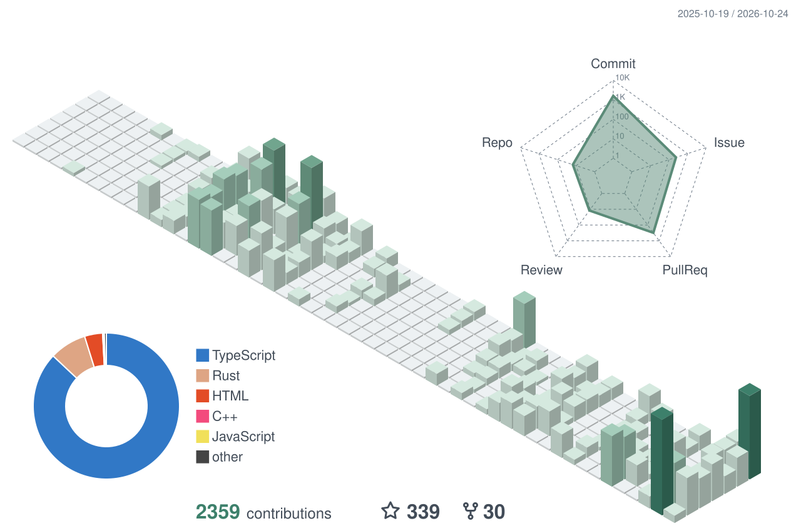

# Hi there, I'm Leonezz 👋

I build tools for reading, planning, and working with AI agents.

`TypeScript` · `React` · `Rust` · `C++`

## On GitHub

  <a href="https://github.com/Leonezz?tab=repositories">
    <picture>
      <source media="(prefers-color-scheme: dark)" srcset="./assets/stats-dark.svg">
      <source media="(prefers-color-scheme: light)" srcset="./assets/stats-light.svg">
      
    </picture>
  </a>
  <a href="https://github.com/Leonezz?tab=repositories">
    <picture>
      <source media="(prefers-color-scheme: dark)" srcset="./assets/languages-dark.svg">
      <source media="(prefers-color-scheme: light)" srcset="./assets/languages-light.svg">
      
    </picture>
  </a>

Public GitHub activity. Language shares reflect repository code size, not time spent coding.

## Selected projects

### [Quire](https://github.com/Leonezz/quire)

A local-first reader for articles, newsletters, papers, and PDFs. Highlights, notes, and an AI reading companion in one place.

macOS · Alpha

### [Tasks Timeline for Obsidian](https://github.com/Leonezz/tasks-timeline-obsidian)

Plan and manage tasks from your vault on a timeline, with a built-in MCP server for AI agents.

Obsidian · Desktop

### [OpenBaud](https://github.com/Leonezz/openbaud)

Turn serial devices into reusable tools for coding agents, with structured commands, auditable actions, and capture/replay.

Serial hardware · MCP

## More tools

- [Obsidian MCP Server](https://github.com/Leonezz/obsidian-mcp-server): give agents access to notes, search, attachments, and active context inside Obsidian.
- [Tasks Timeline for Zotero](https://github.com/Leonezz/tasks-timeline-zotero): plan reading and research tasks alongside your library.
- [Tasks Timeline Components](https://github.com/Leonezz/tasks-timeline-components): shared React components for task and timeline interfaces.

Using [Tasks Calendar Wrapper](https://github.com/Leonezz/obsidian-tasks-calendar-wrapper)? It still receives bug fixes; Tasks Timeline for Obsidian is its continuation.

## Contributions

<picture>
  <source media="(prefers-color-scheme: dark)" srcset="./assets/contributions-dark.svg">
  <source media="(prefers-color-scheme: light)" srcset="./assets/contributions-light.svg">
  
</picture>

Generated from GitHub's contribution calendar. Each building represents a day.

## Say hello

📫 [zhuwenqa@outlook.com](mailto:zhuwenqa@outlook.com)
